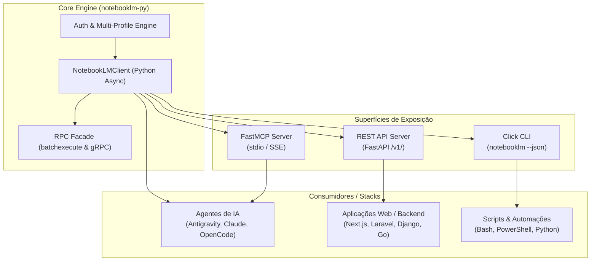

# Guia Completo de Integração Poliglota & Agentes de IA: NotebookLM-py

**Versão da Biblioteca:** `0.8.5+`  
**Público-Alvo:** Agentes de IA Autônomos (Antigravity, Claude Code, OpenCode, Hermes) e Engenheiros Integradores de Stacks Diversas (TypeScript/Node.js, PHP/Laravel, Python, Go, Shell).

---

## 1. Visão Geral da Arquitetura

O `notebooklm-py` expõe quatro superfícies de integração complementares para permitir que agentes de IA e aplicações corporativas operem o Google NotebookLM de forma confiável e com zero custos de API:



---

## 2. As Quatro Superfícies de Integração

| Superfície | Protocolo | Caso de Uso Ideal | Concorrência Suportada |
|---|---|---|---|
| **MCP Server** | JSON-RPC 2.0 (stdio / Streamable HTTP SSE) | Agentes de IA nativos (Antigravity, Cursor, Claude Code) | Multi-profile por flag/sessão |
| **REST Server** | HTTP / JSON (`/v1/*`) | Backends Web (Node/Next.js, PHP/Laravel, Go, microsserviços) | Isolado por cabeçalho `X-NotebookLM-Profile` |
| **CLI Headless** | Subprocess CLI (`--json`) | Tarefas cron, workers assíncronos, scripts de pipeline | Isolado via `NOTEBOOKLM_PROFILE=agent-<id>` |
| **Python SDK** | Async/Await (`import notebooklm`) | Microsserviços e scripts Python nativos | Reentrante por Event Loop |

---

## 3. Autenticação & Estratégia Multi-Profile para Agentes

### 3.1. Tipos de Credenciais

1. **`master_token.json` (Recomendado para Headless e VPS)**:
   - Gerado via `notebooklm login --master-token --account <email>`.
   - Permissão em disco: estritamente `0600` (leitura apenas pelo dono).
   - Não expira em trocas comuns de sessão; re-emite `storage_state.json` automaticamente sob demanda.
2. **`storage_state.json` (Sessão de Cookies de Navegador)**:
   - Gerado pelo comando de login interativo ou capturado via browser cookies (`notebooklm login --browser-cookies chrome`).
   - Contém os cookies `__Secure-1PSID`, `__Secure-1PSIDTS`, etc.

### 3.2. Regra de Isolamento Concorrente para Agentes
**NUNCA compartilhe o mesmo `storage_state.json` entre agentes simultâneos.** Dois agentes escrevendo no mesmo cookie store causam race conditions e invalidação imediata da sessão no Google.

Para cada agente concorrente, utilize um profile isolado:
```bash
# Definir perfil isolado por agente
export NOTEBOOKLM_PROFILE="agent-workspace-1"
# ou no Windows PowerShell:
$env:NOTEBOOKLM_PROFILE = "agent-workspace-1"

# Pré-requisito: copiar o master_token para o perfil do agente
# Local padrão no Windows: C:\Users\<USER>\.notebooklm\profiles\<PROFILE>\master_token.json
# Local no Linux/macOS: ~/.notebooklm/profiles/<PROFILE>/master_token.json
```

### 3.3. Preflight Obrigatório de Autenticação
Antes de qualquer automação pesada, execute o check passivo:
```bash
notebooklm auth check --test --json
```
Exemplo de resposta de sucesso:
```json
{
  "status": "ok",
  "checks": {
    "cookie_presence": true,
    "token_fetch": true
  }
}
```
Se `.checks.token_fetch` for `false`, acione a renovação de tokens antes de prosseguir.

---

## 4. Integração via Servidor REST (FastAPI)

O servidor REST embutido permite que qualquer stack consuma o NotebookLM via chamadas HTTP comuns.

### 4.1. Iniciando o Servidor
```bash
# Iniciar o servidor na porta 8000
uv run python -m notebooklm.server --host 127.0.0.1 --port 8000
```
Ou via Uvicorn diretamente:
```bash
uv run uvicorn notebooklm.server:app --host 127.0.0.1 --port 8000
```

### 4.2. Principais Endpoints (`/v1/`)

| Método | Endpoint | Descrição |
|---|---|---|
| `GET` | `/v1/notebooks` | Lista todos os cadernos da conta ativa |
| `POST` | `/v1/notebooks` | Cria um novo caderno (`{"title": "Nome"}`) |
| `GET` | `/v1/notebooks/{id}` | Obtém detalhes, fontes e metadados do caderno |
| `POST` | `/v1/notebooks/{id}/ask` | Envia pergunta e recebe resposta fundamentada com citações |
| `POST` | `/v1/notebooks/{id}/sources` | Adiciona fontes (URL, texto cru, upload de arquivo) |
| `GET` | `/v1/notebooks/{id}/sources/{src_id}` | Consulta status de processamento da fonte |
| `POST` | `/v1/notebooks/{id}/artifacts/generate` | Inicia geração assíncrona de áudio/podcast, vídeo ou slides |
| `GET` | `/v1/notebooks/{id}/artifacts/{task_id}` | Consulta progresso da tarefa de geração |

### 4.3. Cabeçalhos de Requisição
- `Content-Type: application/json`
- `X-NotebookLM-Profile: <nome-do-perfil>` *(Opcional: roteia a requisição para um perfil específico)*

---

## 5. Exemplos de Implementação por Stack

### 5.1. TypeScript / Node.js (Fetch Nativo)

```typescript
interface AskResponse {
  answer: string;
  conversation_id: string;
  references: Array<{ source_id: string; start_char: number; end_char: number }>;
}

export async function askNotebook(notebookId: string, question: string): Promise<string> {
  const response = await fetch(`http://127.0.0.1:8000/v1/notebooks/${notebookId}/ask`, {
    method: "POST",
    headers: {
      "Content-Type": "application/json",
      "X-NotebookLM-Profile": "crm-production",
    },
    body: JSON.stringify({ question }),
  });

  if (!response.ok) {
    const errorBody = await response.json().catch(() => ({}));
    throw new Error(`NotebookLM API Error ${response.status}: ${JSON.stringify(errorBody)}`);
  }

  const data = (await response.json()) as AskResponse;
  return data.answer;
}
```

### 5.2. PHP / Laravel (Guzzle / Http Client)

```php
<?php

namespace App\Services;

use Illuminate\Support\Facades\Http;
use Exception;

class NotebookLMService
{
    protected string $baseUrl;
    protected string $profile;

    public function __construct()
    {
        $this->baseUrl = config('services.notebooklm.url', 'http://127.0.0.1:8000/v1');
        $this->profile = config('services.notebooklm.profile', 'default');
    }

    public function ask(string $notebookId, string $question): string
    {
        $response = Http::withHeaders([
            'X-NotebookLM-Profile' => $this->profile,
            'Accept' => 'application/json',
        ])->timeout(60)->post("{$this->baseUrl}/notebooks/{$notebookId}/ask", [
            'question' => $question,
        ]);

        if ($response->failed()) {
            throw new Exception("NotebookLM Request failed: " . $response->body());
        }

        return $response->json('answer') ?? '';
    }
}
```

### 5.3. Bash / PowerShell (CLI Headless com JSON)

```bash
# 1. Criar Caderno
NOTEBOOK_JSON=$(notebooklm create "Pesquisa de Mercado" --json)
NOTEBOOK_ID=$(echo $NOTEBOOK_JSON | jq -r '.notebook.id')

# 2. Adicionar Fonte
SOURCE_JSON=$(notebooklm source add "https://exemplo.com/artigo.pdf" -n $NOTEBOOK_ID --json)
SOURCE_ID=$(echo $SOURCE_JSON | jq -r '.source.id')

# 3. Aguardar Processamento (Invariante Crítico!)
notebooklm source wait $SOURCE_ID -n $NOTEBOOK_ID --timeout 300

# 4. Perguntar com Grounding
notebooklm ask "Qual a principal conclusão do documento?" -n $NOTEBOOK_ID --json
```

---

## 6. Invariantes Operacionais Inegociáveis

1. **Nunca pergunte antes de `source wait`**: O endpoint de adicionar fontes (`source add`) é assíncrono. Enviar perguntas antes do status `ready` gera alucinações ou respostas vazias.
2. **Capture sempre os IDs retornados**: Extraia `.notebook.id`, `.source.id` e `.task_id` diretamente dos envelopes JSON.
3. **Downloads exigem ID do artefato**: Sempre use `notebooklm download <tipo> <caminho> -n <notebook_id> -a <artifact_id>`, nunca selecione "o último artefato visível" para evitar race condition.
4. **Encoding em Windows**: Em scripts Python em ambientes Windows, force `sys.stdout.reconfigure(encoding='utf-8')` para evitar falhas `charmap`.
